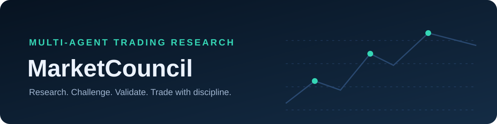
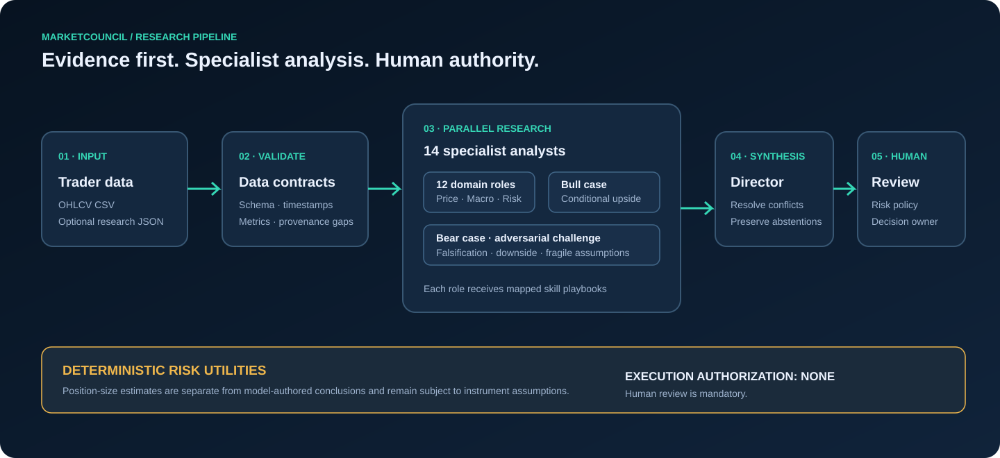
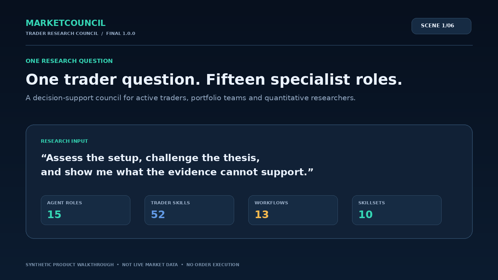
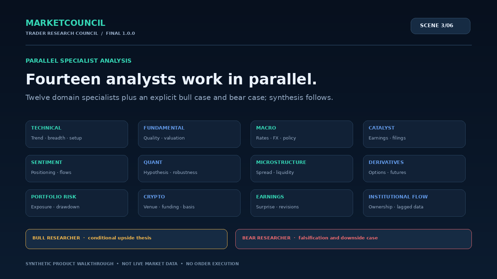
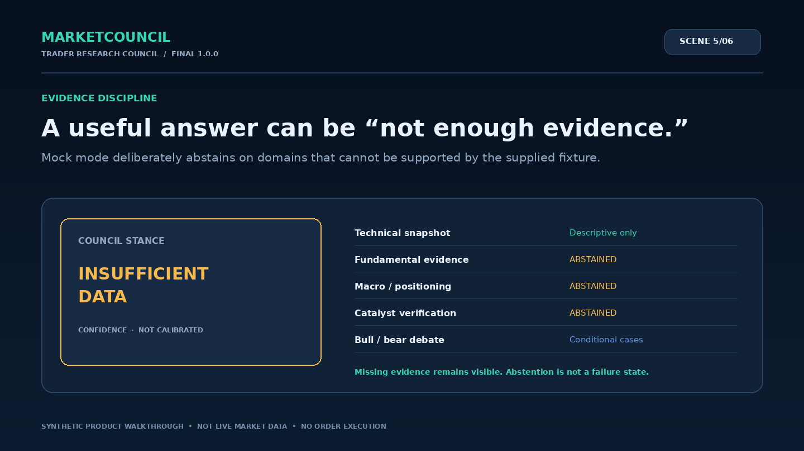
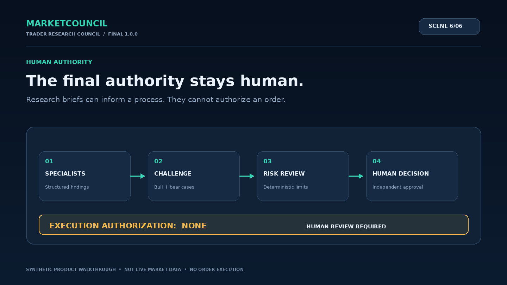

<div align="center">
  
  <h1>MarketCouncil</h1>
  <h3>One Market. Fifteen Specialists. No Unchallenged Thesis.</h3>
  <p><strong>An AI-powered trading research council for serious traders, portfolio managers and quantitative researchers — built to challenge assumptions, expose risk and make every research step inspectable.</strong></p>

  
  
  
  
  
  
  
</div>

<p align="center">
  <a href="#why-marketcouncil">Why MarketCouncil</a> ·
  <a href="#the-research-council">The council</a> ·
  <a href="#74-trader-skills">74 skills</a> ·
  <a href="#market-data-backtesting--paper-trading">Market data & simulation</a> ·
  <a href="#quick-start">Quick start</a> ·
  <a href="#security--risk-boundaries">Security</a>
</p>

---

> **Not another AI signal bot. Your trading research desk, rebuilt as a specialist council.**

MarketCouncil coordinates specialist AI agents to examine a market question from different angles, challenge the thesis, expose missing evidence and produce a structured research brief. It combines **15 agent roles**, **74 trader-focused skill playbooks**, **13 operational workflows** and **10 skillsets** in one Python project.

Use a single compatible model or route different specialist roles to different providers. Work offline with the deterministic demo, bring your own market data, connect optional data providers, run a transparent historical experiment, or use paper/test environments.

**The operating principle:** AI can help organise and challenge research. It does not own the trade, verify every source, guarantee a fill, or authorise live execution.

## Why MarketCouncil

Professional trading decisions rarely come from one chart, one metric or one model response. They require evidence across market structure, fundamentals, catalysts, macro conditions, positioning, derivatives, liquidity and portfolio risk.

MarketCouncil makes those perspectives explicit:

- **Specialists, not one generic prompt.** Domain agents receive assigned skill playbooks and return structured findings.
- **Bull and bear challenge.** Opposing researchers build conditional cases and identify what would invalidate them.
- **Synthesis after analysis.** The synthesis director reconciles evidence, disagreement, confidence and data gaps.
- **Deterministic risk utilities.** Position sizing and portfolio constraints are calculated in code, not delegated to an LLM.
- **Trader-owned workflows.** Skills, workflows and skillsets are portable Markdown/JSON assets—not locked inside one provider.
- **Human decision boundary.** Research output is not a buy/sell instruction or permission to place a live order.

## The research council



The 15 roles are organised into a bounded workflow:

| Research layer | Specialist roles |
|---|---|
| Market and security research | Technical Analyst, Fundamental Analyst, Macro Strategist, Catalyst Researcher, Sentiment Analyst, Quant Researcher |
| Instruments and market structure | Microstructure Analyst, Derivatives Analyst, Crypto Analyst, Earnings Analyst, Institutional Flow Analyst |
| Portfolio and risk | Portfolio Risk Officer |
| Adversarial review | Bull Researcher, Bear Researcher |
| Final synthesis | Synthesis Director |

The 12 domain specialists and the bull/bear researchers can run concurrently (bounded by a configurable worker limit). The synthesis director runs after specialist reports are collected. This is an orchestrated role architecture—not proof that model outputs are independent or correct.

Every role has explicit skill assignments. Skill files and user-supplied research context are treated as untrusted input; they are evidence to analyse, not instructions to obey.

## See the workflow



**[Watch the six-scene MP4 walkthrough](assets/marketcouncil-demo.mp4)** · [Open architecture diagram](assets/council-flow.svg) · [Browse the complete skill catalogue](docs/SKILL_CATALOG.md)

| Specialist analysis | Missing evidence | Human review boundary |
|---|---|---|
|  |  |  |

*All images and video are original product illustrations using synthetic, non-market data. They are not screenshots of live feeds, broker accounts, forecasts or trading recommendations.*

## 74 trader skills

MarketCouncil ships 74 individually discoverable Markdown playbooks. Each skill defines its purpose, required inputs, process, expected output, evidence standard and guardrails.

| Domain | Example capabilities |
|---|---|
| Technical analysis and market internals | Market regime, market breadth, uptrend participation, distribution-day risk, VCP research, breakout planning, episodic pivots |
| Equity fundamentals and selection | Fundamental quality, valuation discipline, growth screening, dividend sustainability, earnings reactions |
| Macro, FX and positioning | Macro event risk, economic calendar review, FX positioning, COT analysis, institutional ownership, cross-asset correlation |
| Derivatives and digital assets | Options strategy and volatility, futures contract sizing and term structure, crypto regime and microstructure |
| Quantitative and relative value | Quant research, pair-trading cointegration, event studies, backtest integrity, robustness and strategy drift |
| Portfolio, risk and process | Portfolio exposure, construction review, drawdown controls, short-side risk, trade discipline, trader memory and postmortems |
| Data quality and research governance | Data-quality audit, catalyst verification, liquidity review, evidence synthesis and adversarial thesis development |

The abbreviated examples above are not the full list. The canonical index is [`skills-index.json`](skills-index.json); portable playbooks are in [`skills/`](skills/), and package copies are in `src/marketcouncil/skill_library/`.

```bash
market-council skills list
market-council skills search "earnings surprise"
market-council skills show vcp-breakout-research
market-council skills validate
```

## 13 workflows · 10 trader skillsets

Workflows define ordered skill sequences, inputs, outputs and human decision gates. Skillsets group capabilities by trader objective.

Example workflows include daily market regime, equity breakout research, earnings-event review, macro and cross-asset review, options volatility, futures contract risk, crypto market regime, portfolio drawdown review, systematic strategy research, pair trading, short-side risk, trade-memory postmortem and dividend-quality review.

The 10 skillsets cover active equities, growth and momentum, dividend income, macro/FX/commodities, options, futures, digital assets, quantitative/systematic research, portfolio risk and trader development.

```bash
market-council workflows list
market-council workflows show daily-market-regime
market-council workflows validate
```

See [`workflows/`](workflows/) and [`skillsets/`](skillsets/).

## Market data, backtesting & paper trading

MarketCouncil includes optional integrations. Provider limits, entitlements, data delays and permitted use are controlled by the vendor and exchange—not by this project.

### Market data

| Provider | Implemented capability | Important boundary |
|---|---|---|
| Twelve Data | REST historical bars and quote snapshots; optional WebSocket price ticks | Supported instruments/symbols and stream credits depend on subscription and entitlement |
| Binance | Public Spot and USD-M crypto-futures REST market data; Spot trade and USD-M aggregate-trade WebSocket streams | These connectors provide crypto market data, not a universal equities/FX/futures feed |
| Local CSV | OHLCV input | User is responsible for data quality, timestamps, adjustments and provenance |

WebSocket output is read-only JSONL. Automatic reconnect/resubscribe, sequence-gap recovery, persistent tick storage, candle construction and provider failover are not implemented.

```bash
# Install optional stream support
python -m pip install -e ".[stream]"

# Twelve Data historical bars and quote snapshot
export TWELVEDATA_API_KEY="<load-from-secret-manager>"
market-council fetch --provider twelvedata --asset-class equity --symbol AAPL \
  --exchange NASDAQ --interval 1day --limit 500 --output ./data/AAPL.csv
market-council quote --provider twelvedata --asset-class equity --symbol AAPL --exchange NASDAQ

# Twelve Data WebSocket price ticks (subscription entitlement required)
market-council stream --provider twelvedata --asset-class equity --symbols AAPL MSFT
market-council stream --provider twelvedata --asset-class fx --symbols EUR/USD USD/JPY

# Binance public Spot and USD-M crypto-futures data
market-council fetch --provider binance --market spot --asset-class crypto \
  --symbol BTCUSDT --interval 1h --limit 500 --output ./data/BTCUSDT.csv
market-council quote --provider binance --market usdm --asset-class crypto_futures --symbol BTCUSDT
market-council stream --provider binance --market spot --symbols BTCUSDT ETHUSDT
market-council stream --provider binance --market usdm --symbols BTCUSDT ETHUSDT
```

### Historical backtesting

The included backtester is a deliberately small, inspectable, single-instrument OHLCV engine. It evaluates completed-bar signals and fills at the next bar open, with configurable simplified commission and slippage assumptions.

```bash
market-council backtest --csv ./data/AAPL.csv --fast 10 --slow 30 \
  --initial-equity 100000 --commission-bps 5 --slippage-bps 5 --bars-per-year 252
```

It is not a venue-grade simulator. It does not model order-book queue priority, market impact, corporate actions, delistings, point-in-time universes, margin/liquidation, borrow, funding, options or portfolio-level multi-asset interactions. A backtest is an experiment, not evidence of future returns.

### Paper and sandbox execution

- **Local paper simulator:** SQLite-persisted, long-only cash-equity simulation with caller-supplied reference prices, configured slippage and fees.
- **Alpaca Paper:** LIMIT orders to the fixed paper endpoint.
- **Binance Spot Testnet:** signed LIMIT orders to the Spot testnet endpoint.
- **Live-money execution:** no live-money order adapter is included.

Use only paper/testnet credentials with these adapters. A timeout or ambiguous provider response can leave an order's status unknown; reconcile using the venue's official interface and client order ID before retrying.

See [Market Data & Backtesting](docs/LIVE_DATA_AND_BACKTESTING.md) and [Paper Trading & API](docs/PAPER_TRADING_API.md).

## Multi-model AI

Install the optional LiteLLM adapter:

```bash
python -m pip install -e ".[ai]"
```

Configure one compatible model for the council:

```bash
export MC_PROVIDER=litellm
export MC_MODEL='openai/<model-id>'
export OPENAI_API_KEY='<load-from-secret-manager>'
```

Or route individual roles to different compatible providers:

```bash
export MC_AGENT_MODELS='{
  "technical_analyst": "openai/<model-id>",
  "fundamental_analyst": "anthropic/<model-id>",
  "macro_strategist": "gemini/<model-id>",
  "bull_researcher": "openai/<model-id>",
  "bear_researcher": "anthropic/<model-id>",
  "synthesis_director": "openai/<model-id>"
}'
```

The provider/model catalogue changes over time. Not every model or provider has been individually tested. Check structured-output support, rate limits, retention, region, terms and data-use policies. Hosted inference sends prompts and supplied research context to that provider; do not send confidential client or trading data unless authorised and provider terms have been reviewed.

## Persistent audit, authentication & API

Install the optional API dependencies:

```bash
python -m pip install -e ".[api]"
market-council users create --username trader_one
market-council serve-api --database ./var/marketcouncil.sqlite3
```

The optional service provides SQLite-backed users, password hashes, hashed opaque sessions, tenant-scoped paper accounts/orders and transactional audit-event insertion. Self-registration is disabled by default; provision users locally.

This is a starter service, not a complete enterprise identity or security platform. MFA/SSO, password recovery, internal rate limiting, external immutable audit storage, distributed database failover and a full administrative permission console are not included.

## Quick start

**Requirements:** Python 3.11+. Core runtime uses the Python standard library; AI, API, WebSocket and development features are optional extras.

```bash
# Create and activate a virtual environment
python -m venv .venv

# macOS / Linux
source .venv/bin/activate

# Windows PowerShell
# .venv\Scripts\Activate.ps1

python -m pip install --upgrade pip
python -m pip install -e .

# Validate and run the deterministic offline demo
market-council skills validate
market-council workflows validate
market-council demo --format markdown
```

No market-data API key or AI-provider credential is required for the deterministic offline demo.

### Analyse an OHLCV file

CSV input requires `timestamp,open,high,low,close,volume`. Timestamps must be strictly ascending and unique after UTC normalization. Prices must be finite and positive; high/low bounds must be consistent; volume must be finite and non-negative.

```bash
market-council analyze \
  --csv ./data/instrument.csv \
  --symbol YOUR-SYMBOL \
  --timeframe 1d \
  --bars-per-year 252 \
  --question "Review the setup, key risks, and missing evidence" \
  --provider mock \
  --format markdown \
  --output ./reports/research-brief.md
```

### Deterministic position sizing

```bash
market-council size \
  --equity 100000 --risk-pct 0.5 --entry 100 --stop 97 --side long \
  --fee-pct 0.05 --slippage-pct 0.05 --max-position-pct 20
```

This is a linear per-unit estimate. It is not a substitute for product-specific futures multipliers, options payoff/Greeks, lot sizes, margin, borrow, funding, taxes, gaps, market impact or portfolio correlation. A stop price does not guarantee a maximum loss.

## Architecture & repository map

```text
Market data / OHLCV CSV / trader-supplied context
                    │
         validation and provenance checks
                    │
       12 domain specialists + bull/bear
                    │
          structured research reports
                    │
             synthesis director
                    │
      deterministic risk and backtest tools
                    │
       SQLite paper ledger and audit events
                    │
        human review · sandbox only
          no live-money execution
```

| Path | Purpose |
|---|---|
| `src/marketcouncil/` | Runtime, agents, providers, data, streaming, backtest, risk, storage, auth, API and paper adapters |
| `skills/` | 74 portable trader playbooks |
| `skills-index.json` | Canonical skill metadata and routing index |
| `workflows/` | 13 workflow manifests |
| `skillsets/` | 10 trader capability bundles |
| `tests/` | Deterministic unit and contract tests |
| `docs/` | Architecture, operating model, risk, integrations and deployment documentation |
| `assets/` | Original SVG, PNG, GIF and MP4 illustrations |
| `deploy/` | Docker Compose and Nginx deployment examples |

## Verification

Run the repository checks locally:

```bash
python -m pip install -e ".[dev,api,stream]"
python scripts/validate_repository.py
python scripts/build_skill_index.py --check
python scripts/build_skill_catalog.py --check
ruff check .
pytest -q
python -m compileall -q src tests scripts
bandit -q -r src/marketcouncil
pip-audit
market-council demo --format json
```

The local source-tree verification recorded **121 passing tests**, successful repository/skill/workflow validation, and a successful offline 15-agent demo with `HUMAN_REVIEW_REQUIRED` and `execution_authorization: NONE`.

Ruff, Bandit and pip-audit were not run in the preparation environment because those tools were unavailable offline. The included GitHub Actions workflow runs them in CI. Review the first hosted CI run before treating the repository as release-cleared. See [`docs/VERIFICATION.md`](docs/VERIFICATION.md).

## Security & risk boundaries

MarketCouncil is **not production-certified** for brokerage, customer-account management, regulated financial services or unattended trading. Before exposing the API or using customer data, obtain an independent security review and penetration test; configure TLS, secret management, backups, monitoring, rate limits, incident response and access controls; and obtain jurisdiction-specific legal/compliance advice.

The software does not independently verify every market-data source, research citation, fundamental value or model claim. Provider availability and data rights depend on each vendor. Backtest results can be invalidated by look-ahead bias, survivorship bias, bad timestamps, corporate actions, unrealistic fills and regime changes.

**No live-money order adapter is included.** Never treat an AI-generated report, model consensus, backtest or position-size calculation as a trade instruction.

See [SECURITY.md](SECURITY.md), [Deployment Hardening](docs/DEPLOYMENT_HARDENING.md) and [Risk & Validation](docs/RISK_AND_VALIDATION.md).

## Final scope

`1.0.0` is the final consolidated feature scope for this project brief—not a promise that the software will never need maintenance or security fixes. The shipped system includes the 74-skill library, 15-role research council, 13 workflows, 10 skillsets, opt-in REST and read-only WebSocket market-data adapters, a single-instrument backtester, local paper simulation, Alpaca Paper and Binance Spot Testnet LIMIT adapters, SQLite persistence, tenant-scoped authentication/API routes and deployment examples.

Known omissions include automatic stream recovery and sequence-gap handling, persistent tick storage, comprehensive news/filings/calendar ingestion, automatic source verification, multi-asset portfolio backtesting, venue-grade execution simulation, derivatives margin accounting, enterprise identity, distributed production storage, live-money execution and independent regulatory/security certification. These are documented limitations, not hidden promises.

## License

MarketCouncil is released under the [MIT License](LICENSE). See [PROVENANCE.md](PROVENANCE.md) for the implementation and research-provenance policy.
